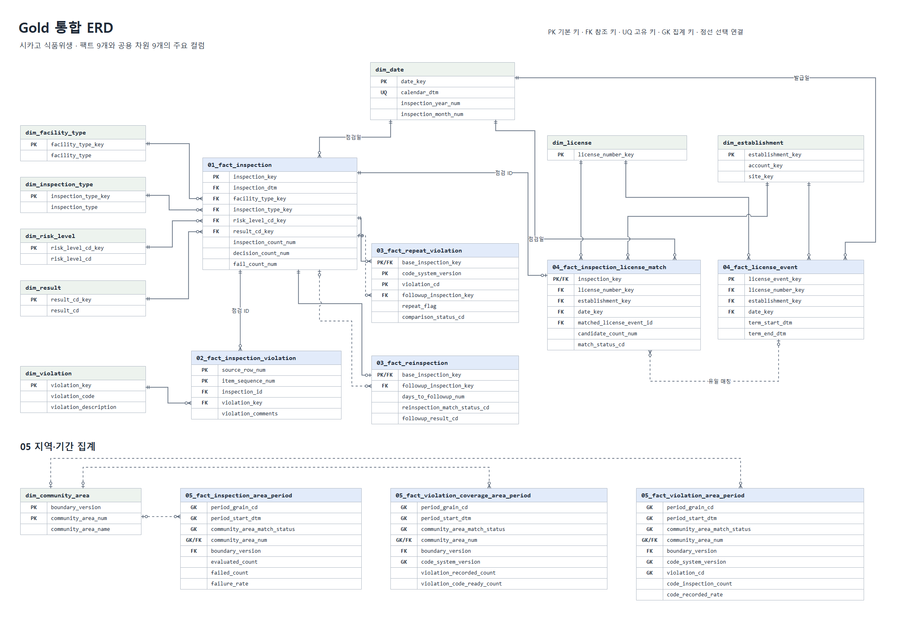

# Chicago Food Safety Data Quality & AI-Ready Platform

시카고시 공개 데이터를 연결해 **점검 성과, 위반 유형, 반복 위반·재검사, 인허가, 지역별 차이**를 분석하는 데이터 프로젝트입니다. 공용 Gold는 **팩트 9개와 차원 9개**, 학습용 AI Ready는 **점검 불합격과 위반 재발을 예측하는 데이터 2종**으로 구성했습니다.

## 1. 팀 소개

**치카치카 · Encore AI Campus MLO 03 Team 2**

| 관점 | 팀원 | GitHub |
| --- | :---: | --- |
| 01 점검 성과 | 이하영 | [@coffeewoouuu](https://github.com/coffeewoouuu) |
| 02 위반 유형 | 이자연 | [@naturedevworks](https://github.com/naturedevworks) |
| 03 반복 위반·재검사 | 김한울 | [@hannyeee](https://github.com/hannyeee) |
| 04 사업체 인허가 | 노진산 | [@jinsan02](https://github.com/jinsan02) |
| 05 지역 분석 | 오정민 | [@OZAM0415](https://github.com/OZAM0415) |

## 2. 프로젝트 개요

| 시카고시 원천 | 규모 | 주요 내용 |
| --- | ---: | --- |
| Food Inspections | 318,627건 | 점검일, 시설 유형, 결과, 위반 원문, 좌표 |
| Business Licenses | 1,212,132건 | 면허 발급·갱신 이력, 사업장, 유효기간 |
| Community Area Boundaries | 77개 지역 | 점검 위치를 배정할 지역 경계 |

### 프로젝트 필요성

**AS-IS · 현재 원천 데이터의 문제점**

- **점검 결과** - 통과·불합격과 함께 폐업·출입 불가 같은 미평가 상태가 섞여 있어, 전체 점검 건수로 불합격률을 계산하면 비율이 달라집니다.
- **위반 원문** - 한 셀에 여러 위반 코드·설명·코멘트가 섞여 있고, 원문이 비어 있는 점검이 90,022건입니다. 코드별 빈도와 재발 여부를 바로 집계하기 어렵습니다.
- **인허가 이력** - 한 면허번호에 발급·갱신 기록이 여러 건 있어, 번호만으로 연결하면 점검 한 건이 여러 행으로 늘어날 수 있습니다.
- **지역 배정** - 점검은 좌표로, 지역은 별도 경계 데이터로 제공됩니다. 좌표가 비어 있거나 경계 밖이면 지역을 특정하기 어렵습니다.

### 프로젝트 목표

- 세 원천을 표준화하고 품질을 검증해, 원천 행·조인 키·지표 분모를 추적할 수 있는 Gold 분석 데이터를 구축합니다.
- 예측 시점에 알 수 있었던 입력과 이후 관측한 정답을 구분해, 점검 불합격과 위반 재발을 예측하는 학습용 AI Ready 데이터를 만듭니다.

## 3. 기술 스택

| 용도 | 기술 |
| --- | --- |
| 처리·저장 |    |
| 공간 연산 |   |
| 검증·설계 |   |

## 4. WBS

| 작업 | 담당 | 기간&nbsp;(KST) | 핵심&nbsp;산출물 | 기록 |
| --- | :---: | :---: | --- | --- |
| 1. 공용 원천 스냅샷 반영 | 노진산 | 11/20 | 점검·인허가·지역 경계 원천, 분할본, 체크섬 | [원천 반영](https://github.com/encore-ai-campus/mlo-03-p2-team2/commit/69d1105) |
| 2.1 점검 성과 분석 | 이하영 | 11/20~11/23 | 업종·기간별 점검 건수와 불합격률 | [산출물 배포](https://github.com/encore-ai-campus/mlo-03-p2-team2/commit/328b3a6) |
| 2.2 위반 유형 분석 | 이자연 | 11/20~11/23 | 위반 Fact·Dimension, 정상·격리 데이터 | [PR #5](https://github.com/encore-ai-campus/mlo-03-p2-team2/pull/5) |
| 2.3 재점검·반복 위반 분석 | 김한울 | 11/20 | 30일 이내 재점검과 동일 위반 반복 집계 | [PR #2](https://github.com/encore-ai-campus/mlo-03-p2-team2/pull/2) |
| 2.4 사업체 인허가 분석 | 노진산 | 11/19~11/20 | 인허가 이력과 점검일 기준 면허 매칭 | [PR #1](https://github.com/encore-ai-campus/mlo-03-p2-team2/pull/1) |
| 2.5 지역별 위생 분석 | 오정민 | 11/20~11/23 | 점검 위치의 지역 배정과 지역·기간별 위반 집계 | [PR #3](https://github.com/encore-ai-campus/mlo-03-p2-team2/pull/3) |
| 3.1 공용 Bronze·Silver 통합 | 이자연 | 11/23 | 공용 Parquet 7개, 행 수 대조, 분할본 복원·체크섬 검증 | [PR #11](https://github.com/encore-ai-campus/mlo-03-p2-team2/pull/11) |
| 3.2 공용 Gold 통합 | 김한울 | 11/23 | 공용 Dimension 9개, Fact 9개, 일괄 생성·검증 코드 | [Gold 일괄 생성](https://github.com/encore-ai-campus/mlo-03-p2-team2/commit/be9f8f1) |
| 3.3 AI Ready 학습 데이터 구축 | 오정민 | 11/23 | 점검 불합격·동일 위반 재관측 예측용 데이터셋 2종 | [PR #16](https://github.com/encore-ai-campus/mlo-03-p2-team2/pull/16) |
| 4. 프로젝트 문서·ERD 정리 | 노진산 | 11/23 | 프로젝트 README와 통합 스타 스키마 ERD | [PR #14](https://github.com/encore-ai-campus/mlo-03-p2-team2/pull/14) |

*기간은 2026년 한국 시간 기준 Git 커밋·반영 기록을 따릅니다.*

### 11월 23일 진행 상태

- **공용 Bronze·Silver · 배포 완료**　원천 3종의 스냅샷을 `06_integration`에 배치했습니다. [PR #11](https://github.com/encore-ai-campus/mlo-03-p2-team2/pull/11)
- **공용 Gold · 검증 통과**　기존 관점별 Gold로 차원 9개와 Fact 9개를 재생성하고, 공통 날짜 4,528개를 통합했습니다.
- **관점별 입력 전환 · 비교 완료**　02번 해시 필드와 04번 점검 키 타입을 맞춰 각 실행 경로에 적용하는 작업이 남았습니다.
- **팀 공용 AI-Ready · 학습용 2종 생성·검증 완료**　점검 직전 불합격과 다음 점검의 동일 위반 재관측을 예측하는 Parquet을 배포했습니다. [PR #16](https://github.com/encore-ai-campus/mlo-03-p2-team2/pull/16)

## 5. 요구사항 명세

| 단계 | 요구사항 | 검증 방법 | 검증 상태 |
| --- | --- | --- | :---: |
| Origin | 분할 원천 복원 및 무결성 확인 | 배포 조각과 복원본의 SHA-256 대조 | ✅ 통과 |
| Bronze | 원천 값·행 수·순서 보존 | 원천 CSV·GeoJSON과 Bronze 비교 | ✅ 통과 |
| Bronze | 원천 파일명·적재 시각·행 번호 기록 | `_SRC_FILE`, `_LOAD_DTM`, `source_row_num` 검사 | ✅ 통과 |
| Silver | 컬럼명·식별자·날짜·결과 코드 표준화 | 원천별 매핑과 Parquet 스키마 대조 | ✅ 통과 |
| Silver | 기본 레코드의 원천 추적 유지 | Bronze·Silver의 행 수, 원천 순번, 키 유일성 비교 | ✅ 통과 |
| 품질 검증 | 결측·중복·변환 예외 기록 | 점검 키 충돌, 날짜·범주 오류와 품질 플래그 대조 | ✅ 통과 |
| 품질 검증 | 위반 파싱 결과를 정상·격리로 구분 | 전체 위반 후보와 정상·격리 조각 수의 합 대조 | ✅ 통과 |
| Gold | 팩트의 행 단위와 조인 키 보존 | 팩트 키 중복, 공용 차원과 점검 참조 확인 | ✅ 통과 |
| Gold | 기간 매칭과 공간 배정의 예외 구분 | 점검일의 면허 유효기간 대조, 좌표와 지역 경계 교차 검사 | ✅ 통과 |
| Gold | 공용 차원 통합과 속성 충돌 검사 | 차원 키 유일성 검사, 01·04 날짜 비교 | ✅ 통과 |
| 공용 입력 전환 | 공용 입력으로 관점별 결과 재현 | 기존 Gold와 호환 입력 적용 후 결과 비교 | ⏳ 전환 대기 |
| AI Ready | 기준일 전 이력 사용 및 시간순 분할 | 입력 시점과 정답 관측일이 규칙에 맞는지 대조 | ✅ 통과 |
| AI Ready | 학습 행의 키와 정답 검증 | 공개 산출물의 키·정답·체크섬 대조 | ✅ 통과 |

[공용 Bronze·Silver 검증](docs/domains/06_integration.md)

## 6. ERD

01 점검 팩트는 **점검 ID 하나에 한 행**입니다. 02 위반 조각과 03 기준·후속 점검은 이 점검 ID를 참조합니다. 01·04는 공용 날짜 차원을, 05의 지역 집계는 공용 지역 차원을 사용합니다.

| 관점 | 한 행의 의미 | 주요 지표 |
| --- | --- | --- |
| 01 점검 성과 | 점검 1건 | 점검·판정·불합격 건수 |
| 02 위반 유형 | 정상 파싱된 위반 조각 1개 | 위반 조각 수, 위반이 기록된 고유 점검 수 |
| 03 반복 위반·재검사 | 기준 점검의 고유 위반 코드 1개 / 기준 불합격 점검 1건 | 재관측 여부 / 재검사 연결 여부와 소요일 |
| 04 사업체 인허가 | 인허가 이력 1건 / 점검별 인허가 매칭 1건 | 이력 수 / 유효기간 후보 수 |
| 05 지역 분석 | 지역·기간 / 지역·기간·코드 버전 / 지역·기간·코드 버전·위반 코드 | 점검 결과 / 위반 관측 범위 / 코드별 고유 점검 수 |

## 7. 주요 프로시저

**Origin → Bronze → Silver·품질 검증 → Gold → AI Ready**

1. **공용 원천·Bronze·Silver** · 원천을 복원하고 `06_integration`에서 점검·인허가·지역 경계 세 테이블을 표준화합니다.
2. **관점별 Gold** · 점검 성과, 위반 유형, 반복 위반·재검사, 인허가, 지역 분석에 쓰는 팩트와 집계를 생성합니다.
3. **공용 Gold** · 관점별 결과를 연결해 공용 차원과 팩트를 생성하고, 키와 참조 관계를 확인합니다.
4. **AI Ready** · 점검 Silver와 02 위반 기록, 03 후속 점검 결과에서 기준일 전 365일 이력과 과제별 정답을 만듭니다. [학습 데이터 생성과 검증](docs/ai_ready/inspection_training.md)

## 8. 수행 결과

| 관점 | 대표 결과 | 확인 자료 |
| --- | --- | --- |
| 01 점검 성과 | 전체 318,627건 중 판정 273,488건, 불합격 61,344건 · **22.43%** | [점검 성과 보고서](docs/domains/01_inspection_proposal.md) |
| 02 위반 유형 | 후보 1,031,073조각 = 정상 1,029,281조각 + 격리 1,792조각 | [위반 유형 결과](reports/02_violation/README.md) |
| 03 반복 위반·재검사 | 비교 가능 위반 코드 333,856건 중 130,574건 재관측 · **39.1%**. 불합격 61,344건 중 54,106건에 1~30일 내 재검사 연결 | [반복 위반·재검사 결과](docs/domains/03_repeat_inspection.md) |
| 04 사업체 인허가 | 유효기간 후보 1건 232,383건, 복수 후보 1,401건, 후보 없음 84,843건 | [기간 매칭 검증](docs/domains/04_license/03_gold/README.md) |
| 05 지역 분석 | 317,238건 지역 배정. 좌표 공란 1,065건과 경계 밖 324건 별도 집계 | [지역 분석 결과](docs/domains/05_geospatial.md) |

### 학습용 AI Ready 데이터

| 예측 과제 | 한 행의 의미 | 전체 행 수 | 실제 양성 | 최종 평가용 행 수 |
| --- | --- | ---: | ---: | ---: |
| 점검 직전 불합격 | 점검 1건 | 273,488 | 불합격 61,344건 · 22.43% | 28,161 |
| 다음 점검의 위반 재발 | 기준 점검의 고유 위반 코드 1개 | 287,535 | 재관측 116,674건 · 40.58% | 47,472 |

재발 학습 데이터는 비교 가능한 Gold 333,856행 중 기준일과 정답 관측일이 서로 다른 기간에 속한 46,321행을 제외합니다. 두 비율은 데이터에 기록된 **실제 정답 분포**입니다.

- **불합격 예시** · 점검 `2646979`의 과거 365일 이력은 점검 1건·불합격 0건입니다. 이번 점검이 불합격이므로 정답은 `true`입니다.
- **위반 재발 예시** · 점검 `2609905`의 코드 `38`은 기준일 전 365일 이력에서 0회였고, 2025년 6월 3일 후속 점검에서 다시 관측돼 정답은 `true`입니다.

학습 데이터 자동화 테스트 **3개 통과**. 실제 산출물의 중복 키, 정답 누락·불일치, 시간 분할 위반은 각각 **0건**입니다. [검증 보고서](reports/ai_ready/inspection_training/README.md)

## 9. 한 줄 회고

| 팀원 | 한 줄 회고 |
| :---: | --- |
| 이하영 | |
| 이자연 | |
| 김한울 | |
| 노진산 | |
| 오정민 | |
