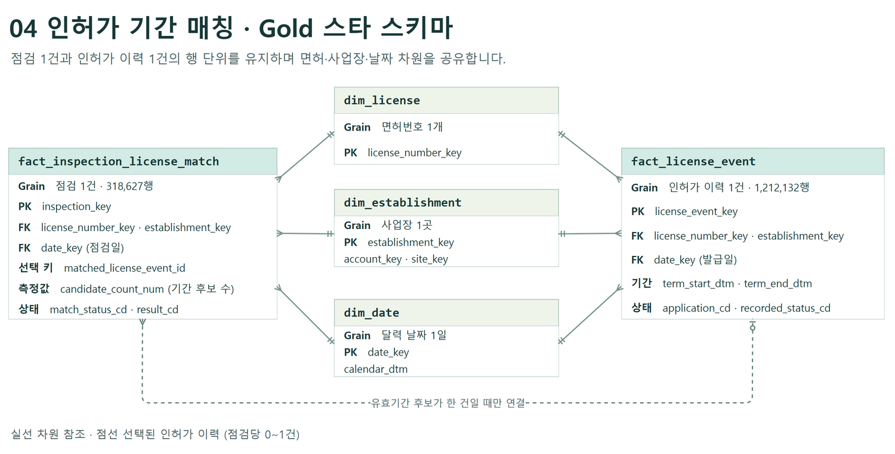
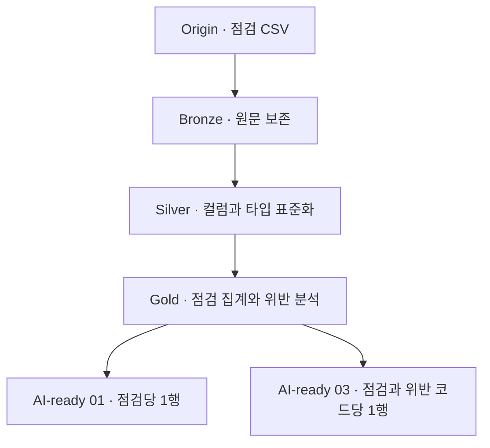

# Chicago Food Safety Data Quality & AI-Ready Platform

시카고시 식품위생 점검, 사업체 인허가, 커뮤니티 지역 경계를 연결해 점검 위험을 분석합니다. **AI가 사용할 수 있는 데이터 구축**이 프로젝트의 최종 목표입니다.

[프로젝트 상세 Wiki](https://github.com/encore-ai-campus/mlo-03-p2-team2/wiki/Project-Details) · [저장소 구조](https://github.com/encore-ai-campus/mlo-03-p2-team2/wiki/Repository-Structure) · [로컬 실행 환경](docs/project_setup_and_sharing.md)

[원천과 AS-IS](#2-프로젝트-개요) · [요구사항](#5-요구사항-명세) · [ERD](#6-erd) · [수행 결과](#8-수행-결과) · [학습 데이터](#학습용-ai-ready-데이터)

## 1. 팀 소개

**치카치카**

| 관점 | 팀원 | GitHub |
| --- | --- | --- |
| 01 점검 성과 | 이하영 | [@coffeewoouuu](https://github.com/coffeewoouuu) |
| 02 위반 유형 | 이자연 | [@naturedevworks](https://github.com/naturedevworks) |
| 03 반복 위반·재검사 | 김한울 | [@hannyeee](https://github.com/hannyeee) |
| 04 사업체 인허가 | 노진산 | [@jinsan02](https://github.com/jinsan02) |
| 05 지역 분석 | 오정민 | [@OZAM0415](https://github.com/OZAM0415) |

## 2. 프로젝트 개요

- **원천**　식품위생 점검 **318,627행**, 인허가 **1,212,132행**, 커뮤니티 지역 **77개**
- **목표**　출처·행 단위·품질 사유를 추적할 수 있는 분석 데이터를 만들고, 학습용 입력과 정답의 관찰 시점을 정의합니다.

### AS-IS · 원천 데이터의 차이

예시는 실제 점검 `2646979`와 인허가 이력 `3031292`를 기준으로 합니다. 지역 경계의 구조는 별도 GeoJSON 예시입니다.

#### 면허번호 컬럼명 차이

- **원천**　점검의 `License #`와 인허가의 `LICENSE NUMBER`에 같은 값 `2398495`가 들어 있습니다. 점검에는 연결에 쓸 수 없는 `0`도 있습니다.
- **처리**　두 컬럼을 문자열 `license_number_key`로 통일하고 `0`은 `null`로 변환합니다.

#### 면허번호 조인과 점검 중복

- **원천**　점검의 `Inspection Date`는 `11/18/2026`입니다. 인허가의 `LICENSE TERM START DATE`와 `LICENSE TERM EXPIRATION DATE`는 각각 `07/16/2025`, `07/15/2027`입니다. 한 면허에 발급·갱신 이력이 여러 개 있을 수 있습니다.
- **처리**　날짜를 `date32`로 맞추고 점검일이 기록된 기간에 포함되는 후보를 셉니다. 후보가 하나일 때만 연결을 확정해 점검 1건당 1행을 유지합니다.

#### 점 좌표와 지역 경계

- **원천**　점검 CSV의 `Longitude`는 `-87.62249083278`, `Latitude`는 `41.89245290794`입니다. 지역 GeoJSON은 `properties.area_numbe`로 지역을 식별하고 `MultiPolygon`으로 경계를 표현합니다.
- **처리**　좌표를 수치형 `[경도, 위도]`로 바꾸고 지역 경계와 공간 교차를 검사합니다. 좌표 공란과 경계 밖은 미배정 사유로 기록합니다.

#### 점검 결과와 위반 상세

- **원천**　`Results`는 `Fail`입니다. `Violations`에는 `50. HOT & COLD WATER AVAILABLE…`처럼 코드·설명·메모가 함께 들어 있습니다.
- **처리**　결과는 `result_cd='FAIL'`로 통일하고, 위반은 조각당 한 행인 상세 테이블로 분리합니다. 점검 건수는 점검 단위로 셉니다.

[시카고시 식품위생 점검](https://data.cityofchicago.org/d/4ijn-s7e5) · [시카고시 사업체 인허가](https://data.cityofchicago.org/d/r5kz-chrr) · [시카고시 지역 경계](https://data.cityofchicago.org/d/igwz-8jzy) · [원천 차이와 예외 처리](https://github.com/encore-ai-campus/mlo-03-p2-team2/wiki/Project-Details#원천과-as-is)

## 3. 기술 스택

| 용도 | 기술 |
| --- | --- |
| 처리·저장 |    |
| 공간 연산 |   |
| 검증·설계 |   |

## 4. WBS

**2026-11-20 금요일 커밋·병합 기록**입니다.

| 작업 ID · 담당 | 작업 | 기록(KST) |
| --- | --- | --- |
| 1.0 공용 기반 | 원천 조사, 적재·표준안, 원천 경로와 체크섬 | [09:49 적재](https://github.com/encore-ai-campus/mlo-03-p2-team2/commit/243ad0d) [16:45 원천 구조](https://github.com/encore-ai-campus/mlo-03-p2-team2/commit/69d1105) |
| 1.1 이하영 | 점검 성과 파이프라인·집계 | [16:41 파이프라인](https://github.com/encore-ai-campus/mlo-03-p2-team2/commit/0e1cd9b) [17:44 공용 경로](https://github.com/encore-ai-campus/mlo-03-p2-team2/commit/7080986) |
| 1.2 이자연 | 위반 분리·격리 대사, Fact·Dim | [17:59 PR #4](https://github.com/encore-ai-campus/mlo-03-p2-team2/pull/4) [18:18 PR #5](https://github.com/encore-ai-campus/mlo-03-p2-team2/pull/5) |
| 1.3 김한울 | 반복 위반·재검사 마트와 기간 검증 | [12:25 기간 규칙](https://github.com/encore-ai-campus/mlo-03-p2-team2/commit/5593942) [17:19 PR #2](https://github.com/encore-ai-campus/mlo-03-p2-team2/pull/2) |
| 1.4 노진산 | 인허가 기간 매칭·검증·Parquet | [16:52 산출물](https://github.com/encore-ai-campus/mlo-03-p2-team2/commit/5e5e779) [16:58 PR #1](https://github.com/encore-ai-campus/mlo-03-p2-team2/pull/1) |
| 1.5 오정민 | 공간 배정·지역 집계·공용 입력 검증 | [16:36 공간 처리](https://github.com/encore-ai-campus/mlo-03-p2-team2/commit/08e03e0) [17:54 PR #3](https://github.com/encore-ai-campus/mlo-03-p2-team2/pull/3) |

### 11월 23일 진행 상태

- **공용 Bronze·Silver · 배포 완료**　원천 3종의 스냅샷을 `06_integration`에 배치했습니다. [PR #11](https://github.com/encore-ai-campus/mlo-03-p2-team2/pull/11) · [통합 가이드](docs/domains/06_integration.md)
- **공용 Gold · 검증 통과**　기존 관점별 Gold로 차원 9개와 Fact 9개를 재생성하고, 공통 날짜 4,528개를 통합했습니다. [Gold 생성·검증 코드](src/gold/build_dimensions.py)
- **관점별 입력 전환 · 비교 완료**　02번 해시 필드와 04번 점검 키 타입을 맞춰 각 실행 경로에 적용하는 작업이 남았습니다. [관점별 비교 기준](docs/domains/06_integration.md#관점별-비교-실행)
- **팀 공용 AI-Ready · 학습용 2종 생성·검증 완료**　점검 직전 불합격과 다음 점검의 동일 위반 재관측을 예측하는 Parquet을 배포했습니다. [PR #16](https://github.com/encore-ai-campus/mlo-03-p2-team2/pull/16)

## 5. 요구사항 명세

✅는 표에 명시한 검증 범위에서 통과한 결과입니다. ⏳는 역할 분담을 마친 후속 작업입니다.

| ID | 단계 | 요구사항 | 검증방법 | 결과 |
| --- | --- | --- | --- | --- |
| O-01 | Origin | 원천 조각과 복원본의 체크섬 일치 | [`restore_origin.py`](src/ingestion/restore_origin.py) | ✅ 원천 6개·조각 4개 |
| B-01 | Bronze | 원천과 Bronze의 행 수·컬럼·값·순서 일치 | [`validate_bronze.py`](src/domains/04_license/validate_bronze.py) | ✅ 04 점검·인허가 일치 |
| B-02 | Bronze | 원천·Bronze의 해시와 적재 기록 일치 | [`validate_bronze.py`](src/domains/04_license/validate_bronze.py) | ✅ 04 매니페스트 대조 |
| S-01 | Silver | 면허번호는 문자열, 날짜는 `date32`, 결과는 표준 코드 | [`validate_silver.py`](src/domains/04_license/validate_silver.py) | ✅ 04 타입·값 일치 |
| S-02 | Silver | Bronze 행 수와 `source_row_num` 보존 | [`validate_silver.py`](src/domains/04_license/validate_silver.py) | ✅ 04 두 테이블 일치 |
| S-03 | 공용 적재·표준화 | 원천 3종 행 수 보존과 배포본 복원 | [`build.py`](src/domains/06_integration/build.py) · [`publish.py`](src/domains/06_integration/publish.py) | ✅ 배포본 7개 대조 |
| Q-01 | 품질 | 결측·파싱 실패·기간 역전 집계 재현 | [`validate_quality.py`](src/domains/04_license/validate_quality.py) | ✅ 04 검사 3/3 |
| Q-02 | 품질 | 위반 후보 = 정상 + 격리. 원천 점검으로 추적 | [`reconciliation.py`](src/domains/02_violation/reconciliation.py) | ✅ [02 대사 기록](reports/02_violation/README.md) |
| G-01 | Gold | 기본키 중복·공란 0건, 필수 FK 유효 | [`validate_gold.py`](src/domains/04_license/validate_gold.py) | ✅ 04 키 검증 |
| G-02 | Gold | 같은 면허의 유효기간 후보를 세고 1개만 확정 | [`validate_gold.py`](src/domains/04_license/validate_gold.py) | ✅ 04 기간 매칭 |
| G-03 | Gold | 동일 차원 행 통합, 같은 키의 속성 충돌 검사 | [`build_dimensions.py`](src/gold/build_dimensions.py) | ✅ 차원 9개 · 날짜 중복 4,528개 제거 |
| G-04 | Gold | 공용 Fact의 행 단위 유일성과 참조 키 보존 | [`build_dimensions.py`](src/gold/build_dimensions.py) | ✅ Fact 9개 검증 |
| T-01 | 입력 전환 | 관점별 경로·타입·메타데이터를 공용 규격에 맞춤 | [관점별 비교 기준](docs/domains/06_integration.md#관점별-비교-실행) | ⏳ 비교 완료 · 전환 대기 |
| A-01 | AI-Ready | 기준일 전의 이력을 사용하고 기준일·정답 관측일을 시간순으로 분할 | [`test_inspection_training.py`](https://github.com/encore-ai-campus/mlo-03-p2-team2/blob/main/tests/ai_ready/test_inspection_training.py) | ✅ 2종 시간 분할 위반 0건 |
| A-02 | AI-Ready | 한 행의 키를 유일하게 유지하고 정답 누락과 파일 변경 여부를 확인 | [`build_inspection_training.py --verify`](https://github.com/encore-ai-campus/mlo-03-p2-team2/blob/main/src/ai_ready/build_inspection_training.py) · [대조 결과](https://github.com/encore-ai-campus/mlo-03-p2-team2/blob/main/reports/ai_ready/inspection_training/README.md) | ✅ 키 중복·정답 누락 0건, 체크섬 일치 |

공용 Bronze·Silver는 [Bronze 원천 검증](src/bronze/check_integration_bronze.py)과 [Silver 스키마 검증](src/silver/validate_integration_silver.py)으로도 확인합니다. 02번은 정상 **1,029,281조각**과 격리 **1,792조각**을 합쳐 후보 **1,031,073조각**과 대조했습니다.

### 관점별 사용자와 분석 질문

- **01 점검 배정 담당자**　어떤 유형에서 다음 점검의 불합격 위험이 높은가?
- **02 교육 기획자**　다음 점검에서 집중해서 살필 위반 유형은 무엇인가?
- **03 재점검 담당자**　직전 위반이 반복되거나 후속 점검이 불합격할 위험은 어느 정도인가?
- **04 인허가 분석가**　점검 당시 사업장을 어느 인허가 이력과 연결할 수 있는가?
- **05 지역 운영 담당자**　다음 기간에 우선적으로 살필 지역은 어디인가?

[페르소나·시나리오·필요 데이터·수용 기준](https://github.com/encore-ai-campus/mlo-03-p2-team2/wiki/Project-Details#요구사항-명세)

## 6. ERD

아래는 **04번에서 검증한 Gold 스타 스키마**입니다. draw.io 두 번째 탭에서 초기 공용 모델 검토안을 볼 수 있습니다.

[편집 가능한 draw.io](docs/chicago_food_star_schema.drawio) · [테이블의 한 행과 측정값](https://github.com/encore-ai-campus/mlo-03-p2-team2/wiki/Project-Details#erd와-측정값)

### Fact·마트의 한 행과 측정값

아래는 현재 공용 Gold에서 생성하는 Fact 9개입니다.

- **`01_fact_inspection`** 점검 1건(`inspection_key`). 표준 결과에서 평가·불합격 건수를 집계합니다. 불합격률은 `불합격 건수 ÷ 평가 완료 건수`입니다.
- **`02_fact_inspection_violation`** 정상 위반 조각 1개(`source_row_num` × `item_sequence_num`). 품질 검사를 통과한 위반 조각을 셉니다.
- **`03_fact_repeat_violation`** 기준 점검 × 위반 코드 버전 × 코드. 비교 가능한 다음 점검에서 같은 코드가 다시 관측됐는지 기록합니다.
- **`03_fact_reinspection`** 기준 불합격 점검 1건. 후속 점검의 연결 여부, 경과일, 결과를 기록합니다.
- **`04_fact_inspection_license_match`** 점검 1건(`inspection_key`). 면허번호와 기간이 모두 맞는 인허가 이력 수를 `candidate_count_num`에 기록합니다.
- **`04_fact_license_event`** 인허가 이력 1건(`license_event_key`). 해당 행 수가 발급·갱신 등 이력 건수입니다.
- **`05_fact_inspection_area_period`** 기간 단위 × 시작일 × 지역 배정 결과. 점검·평가 완료·불합격 건수를 집계합니다.
- **`05_fact_violation_coverage_area_period`** 지역·기간 집계 키 × 위반 코드 버전. 관측·파싱 상태별 점검 수로 위반율 분모를 구분합니다.
- **`05_fact_violation_area_period`** 위반 관측 범위 키 × 위반 코드. 해당 코드가 관측된 점검 건수를 집계합니다.

04번의 두 Fact는 `dim_license`, `dim_establishment`, `dim_date`를 참조합니다. 날짜 차원은 점검 Fact에서 **점검일**, 인허가 Fact에서 **발급일**입니다. 공용 Gold의 `dim_date`는 점검일과 인허가 날짜에 함께 등장하는 날짜를 한 행으로 관리합니다.

## 7. 주요 프로시저

**목표 흐름**　Origin → Bronze → Silver(표준화·품질 검증) → Gold → AI-Ready

1. **Origin**　공용 CSV를 복원하고 GeoJSON·설명 JSON과 함께 체크섬을 확인합니다. [`restore_origin.py`](src/ingestion/restore_origin.py)
2. **Bronze**　값·순서·`source_row_num`을 보존한 Parquet를 만듭니다. 04 [`01_bronze.py`](src/domains/04_license/01_bronze.py)
3. **Silver 표준화**　식별자·날짜·결과 코드를 표준화합니다. 04 [`02_normalize.py`](src/domains/04_license/02_normalize.py)
4. **품질 검증**　Bronze와 Silver의 결측·파싱·기간 예외를 대조합니다. 04 [`03_quality.py`](src/domains/04_license/03_quality.py)
5. **Gold**　관점별 Fact·Dim·마트를 만든 뒤 공용 차원·Fact를 구성합니다. 04 [`04_modeling.py`](src/domains/04_license/04_modeling.py) · 공용 [`build_dimensions.py`](src/gold/build_dimensions.py)
6. **AI-Ready**　04의 Silver 점검본에 02의 위반 기록과 03의 후속 점검 비교 결과를 연결합니다. 과제별 기준일과 정답을 정하고 학습·검증·테스트를 시간순으로 나눕니다. [생성·검증 방법](https://github.com/encore-ai-campus/mlo-03-p2-team2/blob/main/docs/ai_ready/inspection_training.md#생성과-검증)

팀 공용 Bronze·Silver의 생성과 배포 검증은 [`build.py`](src/domains/06_integration/build.py)와 [`publish.py`](src/domains/06_integration/publish.py)를 사용합니다. 04번 전체 실행과 재검증은 [`run_pipeline.py`](src/domains/04_license/run_pipeline.py)를 사용합니다. [재현 명령과 예외 처리](https://github.com/encore-ai-campus/mlo-03-p2-team2/wiki/Project-Details#시연)

## 8. 수행 결과

### 실제 점검 2건의 단계별 변화

같은 점검 ID를 따라가며 단계별 파일에서 확인한 값입니다. Silver의 `inspection_dtm`은 `date32`이고, Gold에서는 판정·불합격 건수를 집계할 수 있도록 행마다 0 또는 1을 기록합니다.

| 단계 · 파일 | 점검 `2646979` | 점검 `2609905` |
| --- | --- | --- |
| [Origin CSV](https://github.com/encore-ai-campus/mlo-03-p2-team2/tree/main/data/00_origin) | `11/18/2026` · `Fail` | `01/02/2025` · `Pass` |
| [04 Bronze Parquet](https://github.com/encore-ai-campus/mlo-03-p2-team2/blob/main/data/01_bronze/04_license/04_food_inspections.parquet) | 원문 보존 · 원천 순번 `4` | 원문 보존 · 원천 순번 `33448` |
| [04 Silver Parquet](https://github.com/encore-ai-campus/mlo-03-p2-team2/blob/main/data/02_silver/04_license/04_food_inspections.parquet) | `2026-11-18` · `FAIL` | `2025-01-02` · `PASS` |
| [01 Gold 점검 Fact](https://github.com/encore-ai-campus/mlo-03-p2-team2/blob/main/data/03_gold/facts/01_fact_inspection.parquet) | 판정 `1` · 불합격 `1` | 판정 `1` · 불합격 `0` |

04 Bronze와 Silver는 점검 **318,627행**과 인허가 **1,212,132행**을 각각 유지했습니다. 04 Gold에서 점검일에 유효한 인허가 후보가 1개인 점검은 **232,383건**, 여러 개인 점검은 **1,401건**, 0개인 점검은 **84,843건**입니다. 04 단계 검증은 **39개 통과**했습니다. [04 검증 보고서](reports/04_license/README.md) · [관점별 결과](https://github.com/encore-ai-campus/mlo-03-p2-team2/wiki/Project-Details#수행-결과)

### 학습용 AI-ready 데이터

| 예측 과제 | 한 행과 정답 | 행 수 |
| --- | --- | ---: |
| 점검 직전 불합격 예측 | 점검 1건. 해당 점검이 `FAIL`이면 양성 | 273,488 |
| 기준 점검 결과 확인 직후 위반 재관측 예측 | 기준 점검의 고유 위반 코드 1개. 비교 가능한 다음 점검에서 같은 버전의 코드가 관측되면 양성 | 287,535 |

- **01 불합격 예시**　점검 `2646979`의 입력에는 직전 365일 점검 `1건`, 불합격 `0건`이 들어갑니다. 당일 실제 결과가 `FAIL`이어서 정답 `label_fail_flag`는 `true`입니다. [01 학습 Parquet](https://github.com/encore-ai-campus/mlo-03-p2-team2/blob/main/data/ai_ready/inspection_training/ac0d0f3f4f33656e78a6/01_preinspection_failure.parquet)
- **03 위반 재관측 예시**　02 Gold에는 점검 `2609905`와 `2618455`에 코드 `38`이 각각 한 행씩 있습니다. 03 Gold가 두 점검을 연결합니다. 학습 행은 `2609905`의 코드 `38` 한 건으로, 기준일 전 같은 코드의 관측 횟수는 `0`입니다. `2025-06-03` 후속 점검에서 코드 `38`이 관측돼 정답 `label_repeat_flag`는 `true`입니다. [02 위반 Parquet](https://github.com/encore-ai-campus/mlo-03-p2-team2/blob/main/data/03_gold/02_violation/02_violations_analysis_mart.parquet) · [03 비교 Parquet](https://github.com/encore-ai-campus/mlo-03-p2-team2/blob/main/data/03_gold/03_repeat_inspection/03_repeat_violation_mart.parquet) · [03 학습 Parquet](https://github.com/encore-ai-campus/mlo-03-p2-team2/blob/main/data/ai_ready/inspection_training/ac0d0f3f4f33656e78a6/03_next_inspection_violation_recurrence.parquet)

두 데이터셋의 과거 이력은 같은 면허번호의 기준일 전 365일에서 계산합니다. 위반 재관측 데이터는 후속 위반을 비교할 수 있는 사례를 사용합니다. 기준일과 정답 관측일이 같은 구간에 속하도록 2023년과 2025년의 시작일을 기준으로 학습·검증·테스트를 나눴습니다.

[과제별 입력과 정답](https://github.com/encore-ai-campus/mlo-03-p2-team2/blob/main/docs/ai_ready/inspection_training.md) · [시간순 분할과 검증 결과](https://github.com/encore-ai-campus/mlo-03-p2-team2/blob/main/reports/ai_ready/inspection_training/README.md)

## 9. 한 줄 회고

| 팀원 | 한 줄 회고 |
| --- | --- |
| 이하영 | |
| 이자연 | |
| 김한울 | |
| 노진산 | |
| 오정민 | |
