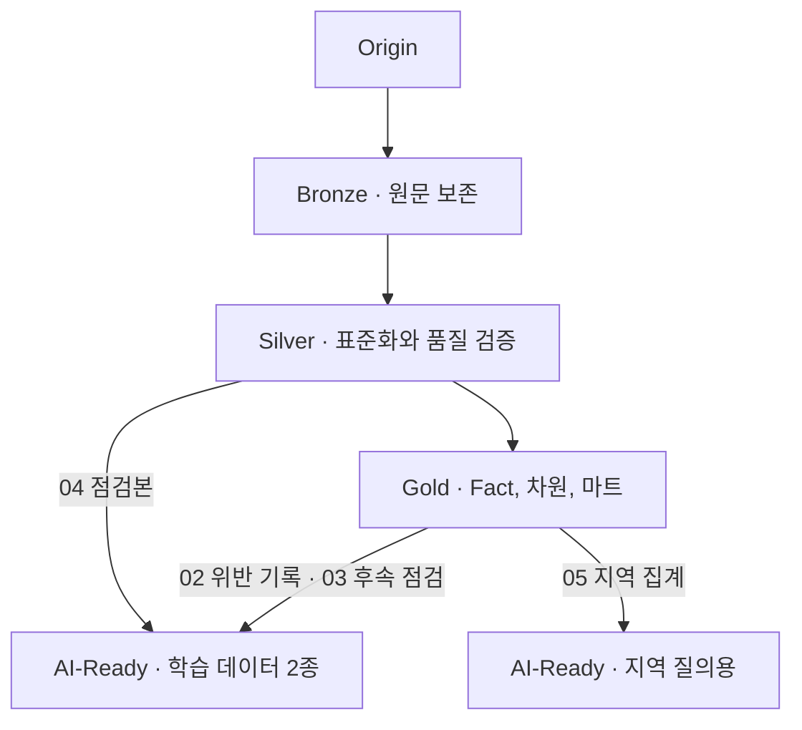

# Chicago Food Safety Data Quality & AI-Ready Platform

시카고 식품위생 점검 한 건에 어떤 인허가 이력과 위반 기록을 붙일 수 있을까? 치카치카는 시카고시 공개 데이터에서 점검일에 유효한 인허가를 찾고, 점검 위치를 커뮤니티 지역에 배정했다. 그 결과로 점검·위반 지표를 조회하는 Gold와 두 가지 예측 과제에 쓸 학습 데이터를 만들었다.

| 주요 결과 | 확인한 범위 |
| --- | --- |
| **점검 318,627건** | 공용 Bronze·Silver에서 원천 행 수 유지 |
| **인허가 매칭 232,383건** | 면허번호와 점검일 조건을 모두 충족한 후보가 한 건인 점검 |
| **차원 9개 · Fact 9개** | 관점별 Gold를 공용 모델로 구성하고 키와 참조 관계 검증 |
| **학습 데이터 2종** | 점검 직전 불합격 273,488행, 다음 점검의 동일 위반 재관측 287,535행 |

[팀 소개](#1-팀-소개) · [프로젝트 개요](#2-프로젝트-개요) · [기술 스택](#3-기술-스택) · [WBS](#4-wbs) · [요구사항](#5-요구사항-명세) · [ERD](#6-erd) · [실행](#7-주요-프로시저) · [수행 결과](#8-수행-결과) · [회고](#9-한-줄-회고)

[프로젝트 상세 Wiki](https://github.com/encore-ai-campus/mlo-03-p2-team2/wiki/Project-Details) · [저장소 구조](https://github.com/encore-ai-campus/mlo-03-p2-team2/wiki/Repository-Structure) · [실행 환경](docs/project_setup_and_sharing.md) · [학습 데이터](#학습용-ai-ready-데이터)

## 1. 팀 소개

**치카치카**

| 관점 | 팀원 | GitHub |
| --- | :---: | --- |
| 01 점검 성과 | 이하영 | [@coffeewoouuu](https://github.com/coffeewoouuu) |
| 02 위반 유형 | 이자연 | [@naturedevworks](https://github.com/naturedevworks) |
| 03 반복 위반·재검사 | 김한울 | [@hannyeee](https://github.com/hannyeee) |
| 04 사업체 인허가 | 노진산 | [@jinsan02](https://github.com/jinsan02) |
| 05 지역 분석 | 오정민 | [@OZAM0415](https://github.com/OZAM0415) |

## 2. 프로젝트 개요

| 시카고시 공개 데이터 | 공용 스냅샷 | 한 행의 의미 |
| --- | ---: | --- |
| [식품위생 점검](https://data.cityofchicago.org/d/4ijn-s7e5) | 318,627행 | 위생점검 1건 |
| [사업체 인허가](https://data.cityofchicago.org/d/r5kz-chrr) | 1,212,132행 | 인허가 이력 1건 |
| [커뮤니티 지역 경계](https://data.cityofchicago.org/d/igwz-8jzy) | 77개 | 지역 1곳 |

공용 Bronze와 Silver는 원천 행을 보존한다. 조인으로 행이 늘어나는 경우에는 분석에 필요한 행 단위를 정해 파생 테이블에 기록했다.

### 프로젝트 필요성

실제 점검 `2646979`와 인허가 이력 `3031292`를 따라가면 컬럼명, 날짜, 공간 정보가 어디서 달라지는지 확인할 수 있다. 경계 형식은 지역 GeoJSON을 기준으로 했다.

- **점검 결과** - 통과·불합격과 함께 폐업·출입 불가 같은 미평가 상태가 섞여 있어, 전체 점검 건수로 불합격률을 계산하면 비율이 달라집니다.
- **위반 원문** - 한 셀에 여러 위반 코드·설명·코멘트가 섞여 있고, 원문이 비어 있는 점검이 90,022건입니다. 코드별 빈도와 재발 여부를 바로 집계하기 어렵습니다.
- **인허가 이력** - 한 면허번호에 발급·갱신 기록이 여러 건 있어, 번호만으로 연결하면 점검 한 건이 여러 행으로 늘어날 수 있습니다.
- **지역 배정** - 점검은 좌표로, 지역은 별도 경계 데이터로 제공됩니다. 좌표가 비어 있거나 경계 밖이면 지역을 특정하기 어렵습니다.

같은 값 `2398495`가 점검 CSV의 `License #`와 인허가 CSV의 `LICENSE NUMBER`에 들어 있다. 두 컬럼을 문자열 `license_number_key`로 연결하고, 점검의 `0`은 결측으로 처리했다.

#### 면허번호 조인과 점검 중복

면허번호 하나에 발급·갱신 이력이 쌓이므로 면허번호만 연결하면 점검 행이 늘어날 수 있다. 점검일 `2026-11-18`과 유효기간 `2025-07-16`~`2027-07-15`를 `date32`로 비교했다. 기간 조건까지 맞는 후보가 한 건일 때 연결을 확정하고, 후보 수와 상태는 점검당 한 행에 남겼다.

#### 점 좌표와 지역 경계

점검 좌표 `[-87.62249083278, 41.89245290794]`는 `[경도, 위도]` 순서로 GeoJSON의 `MultiPolygon`과 교차를 검사했다. 교차한 경계가 하나면 `properties.area_numbe`로 지역을 배정했다. 좌표 공란과 경계 밖은 미배정 사유로 기록했다.

#### 점검 결과와 위반 상세

`Results`의 `Fail`은 `result_cd`의 `FAIL`로 통일했다. `50. HOT & COLD WATER AVAILABLE…` 같은 위반 텍스트는 코드·설명·메모로 파싱해 위반 조각당 한 행으로 저장했다. 점검 건수는 위반 상세의 행 수와 별도로 점검 키를 기준으로 센다.

[원천 차이와 예외 처리](https://github.com/encore-ai-campus/mlo-03-p2-team2/wiki/Project-Details#원천과-as-is)

## 3. 기술 스택

| 용도 | 기술 |
| --- | --- |
| 처리·저장 | Python 3.14, pandas, Apache Parquet |
| 공간 연산 | Shapely, GeoJSON |
| 검증·설계 | pytest, draw.io |

## 4. WBS

| 작업 | 담당 | 기간&nbsp;(KST) | 핵심&nbsp;산출물 | 기록 |
| --- | :---: | :---: | --- | --- |
| 1. 공용 원천 스냅샷 반영 | 노&#8288;진&#8288;산 | 11/20 | 점검·인허가·지역 경계 원천, 분할본, 체크섬 | [원천 반영](https://github.com/encore-ai-campus/mlo-03-p2-team2/commit/69d1105) |
| 2.1 점검 성과 분석 | 이&#8288;하&#8288;영 | 11/20~ 11/23 | 업종·기간별 점검 건수와 불합격률 | [산출물 배포](https://github.com/encore-ai-campus/mlo-03-p2-team2/commit/328b3a6) |
| 2.2 위반 유형 분석 | 이&#8288;자&#8288;연 | 11/20~ 11/23 | 위반 Fact·Dimension, 정상·격리 데이터 | [PR #5](https://github.com/encore-ai-campus/mlo-03-p2-team2/pull/5) |
| 2.3 재점검·반복 위반 분석 | 김&#8288;한&#8288;울 | 11/20 | 30일 이내 재점검과 동일 위반 반복 집계 | [PR #2](https://github.com/encore-ai-campus/mlo-03-p2-team2/pull/2) |
| 2.4 사업체 인허가 분석 | 노&#8288;진&#8288;산 | 11/19~ 11/20 | 인허가 이력과 점검일 기준 면허 매칭 | [PR #1](https://github.com/encore-ai-campus/mlo-03-p2-team2/pull/1) |
| 2.5 지역별 위생 분석 | 오&#8288;정&#8288;민 | 11/20~ 11/23 | 점검 위치의 지역 배정과 지역·기간별 위반 집계 | [PR #3](https://github.com/encore-ai-campus/mlo-03-p2-team2/pull/3) |
| 3.1 공용 Bronze·Silver 통합 | 이&#8288;자&#8288;연 | 11/23 | 공용 Parquet 7개, 행 수 대조, 분할본 복원·체크섬 검증 | [PR #11](https://github.com/encore-ai-campus/mlo-03-p2-team2/pull/11) |
| 3.2 공용 Gold 통합 | 김&#8288;한&#8288;울 | 11/23 | 공용 Dimension 9개, Fact 9개, 일괄 생성·검증 코드 | [Gold 일괄 생성](https://github.com/encore-ai-campus/mlo-03-p2-team2/commit/be9f8f1) |
| 3.3 AI Ready 학습 데이터 구축 | 오&#8288;정&#8288;민 | 11/23 | 점검 불합격·동일 위반 재관측 예측용 데이터셋 2종 | [PR #16](https://github.com/encore-ai-campus/mlo-03-p2-team2/pull/16) |
| 4. 프로젝트 문서·ERD 정리 | 노&#8288;진&#8288;산 | 11/23 | 프로젝트 README와 통합 스타 스키마 ERD | [PR #14](https://github.com/encore-ai-campus/mlo-03-p2-team2/pull/14) |

| 작업 ID · 담당 | 작업 | 커밋·PR |
| --- | --- | --- |
| 1.0 공용 기반 | 원천 조사, 적재·표준안, 경로와 체크섬 | [09:49 적재](https://github.com/encore-ai-campus/mlo-03-p2-team2/commit/243ad0d) · [16:45 원천 구조](https://github.com/encore-ai-campus/mlo-03-p2-team2/commit/69d1105) |
| 1.1 이하영 | 점검 성과 파이프라인과 집계 | [16:41 파이프라인](https://github.com/encore-ai-campus/mlo-03-p2-team2/commit/0e1cd9b) · [17:44 공용 경로](https://github.com/encore-ai-campus/mlo-03-p2-team2/commit/7080986) |
| 1.2 이자연 | 위반 분리, 격리 대사, Fact·Dim | [17:59 PR #4](https://github.com/encore-ai-campus/mlo-03-p2-team2/pull/4) · [18:18 PR #5](https://github.com/encore-ai-campus/mlo-03-p2-team2/pull/5) |
| 1.3 김한울 | 반복 위반·재검사 마트와 기간 검증 | [12:25 기간 규칙](https://github.com/encore-ai-campus/mlo-03-p2-team2/commit/5593942) · [17:19 PR #2](https://github.com/encore-ai-campus/mlo-03-p2-team2/pull/2) |
| 1.4 노진산 | 인허가 기간 매칭, 검증, Parquet | [16:52 산출물](https://github.com/encore-ai-campus/mlo-03-p2-team2/commit/5e5e779) · [16:58 PR #1](https://github.com/encore-ai-campus/mlo-03-p2-team2/pull/1) |
| 1.5 오정민 | 지역 배정, 집계, 공용 입력 검증 | [16:36 공간 처리](https://github.com/encore-ai-campus/mlo-03-p2-team2/commit/08e03e0) · [17:54 PR #3](https://github.com/encore-ai-campus/mlo-03-p2-team2/pull/3) |

## 5. 요구사항 명세

| 단계 | 요구사항 | 검증 방법 | 검&#8288;증&nbsp;상&#8288;태 |
| --- | --- | --- | :---: |
| Origin | 분할 원천 복원 및 무결성 확인 | 배포 조각과 복원본의 SHA-256 대조 | ✅ 통과 |
| Bronze | 원천 값·행 수·순서 보존 | 원천 CSV·GeoJSON과 Bronze 비교 | ✅ 통과 |
| Bronze | 원천 파일명·적재 시각·행 번호 기록 | `_SRC_FILE`, `_LOAD_DTM`, `source_row_num` 검사 | ✅ 통과 |
| Silver | 컬럼명·식별자·날짜·결과 코드 표준화 | 원천별 매핑과 Parquet 스키마 대조 | ✅ 통과 |
| Silver | 기본 레코드의 원천 추적 유지 | Bronze·Silver의 행 수, 원천 순번, 키 유일성 비교 | ✅ 통과 |
| 품질 검증 | 결측·중복·변환 예외 기록 | 점검 키 충돌, 날짜·범주 오류와 품질 플래그 대조 | ✅ 통과 |
| 품질 검증 | 위반 파싱 결과를 정상·격리로 구분 | 전체 위반 후보와 정상·격리 조각 수의 합 대조 | ✅ 통과 |
| Gold | 팩트의 행 단위와 조인 키 보존 | 팩트 키 중복, 공용 차원과 점검 참조 확인 | ✅ 통과 |
| Gold | 기간 매칭과 공간 배정의 예외 구분 | 점검일의 면허 유효기간 대조, 좌표와 지역 경계 교차 검사 | ✅ 통과 |
| Gold | 공용 차원 통합과 속성 충돌 검사 | 차원 키 유일성 검사, 01·04 날짜 비교 | ✅ 통과 |
| 공용 입력 전환 | 공용 Bronze·Silver로 01~05 결과와 학습 데이터 재현 | [일괄 실행 및 결과 대조](docs/domains/06_integration.md#관점별-비교-실행) | ✅ 통과 |
| AI Ready | 기준일 전 이력 사용 및 시간순 분할 | 입력 시점과 정답 관측일이 규칙에 맞는지 대조 | ✅ 통과 |
| AI Ready | 학습 행의 키와 정답 검증 | 공개 산출물의 키·정답·체크섬 대조 | ✅ 통과 |

02에서 분리한 위반 후보 **1,031,073조각**을 정상 **1,029,281조각**과 격리 **1,792조각**으로 대사했다. 정상과 격리 조각 모두 원천 점검을 추적할 수 있다. [Bronze 원천 검증](src/bronze/check_integration_bronze.py) · [Silver 스키마 검증](src/silver/validate_integration_silver.py)

### 관점별 사용자와 분석 질문

| 사용자 | 분석 질문 |
| --- | --- |
| 01 점검 배정 담당자 | 다음 점검에서 불합격 위험이 높은 유형은 무엇인가? |
| 02 교육 기획자 | 다음 점검에서 집중해서 살필 위반 유형은 무엇인가? |
| 03 재점검 담당자 | 직전 위반이 반복되거나 후속 점검이 불합격할 위험은 어느 정도인가? |
| 04 인허가 분석가 | 점검 당시 사업장은 어느 인허가 이력과 연결되는가? |
| 05 지역 운영 담당자 | 다음 기간에 우선적으로 살필 지역은 어디인가? |

[페르소나·시나리오·필요 데이터·수용 기준](https://github.com/encore-ai-campus/mlo-03-p2-team2/wiki/Project-Details#요구사항-명세)

## 6. ERD

그림의 기준은 04 인허가 Gold다. 점검 매칭 Fact와 인허가 이력 Fact가 면허·사업장·날짜 차원을 공유한다. draw.io 두 번째 탭에는 초기 공용 모델 검토안이 있다.

01 점검 팩트는 **점검 ID 하나에 한 행**입니다. 02 위반 조각과 03 기준·후속 점검은 이 점검 ID를 참조합니다. 01·04는 공용 날짜 차원을, 05의 지역 집계는 공용 지역 차원을 사용합니다.

[편집 가능한 draw.io](docs/chicago_food_star_schema.drawio) · [테이블의 한 행과 측정값](https://github.com/encore-ai-campus/mlo-03-p2-team2/wiki/Project-Details#erd와-측정값)

### Fact·마트의 한 행과 측정값

| 공용 Gold Fact | 한 행과 주요 값 |
| --- | --- |
| `01_fact_inspection` | 점검 1건(`inspection_key`). 평가 완료·불합격 지표. |
| `02_fact_inspection_violation` | 정상 위반 조각 1개(`source_row_num` × `item_sequence_num`). |
| `03_fact_repeat_violation` | 기준 점검 × 코드 체계 × 위반 코드. 다음 비교 점검의 동일 코드 관측 여부. |
| `03_fact_reinspection` | 기준 불합격 점검 1건. 후속 점검 연결 상태, 경과일, 결과. |
| `04_fact_inspection_license_match` | 점검 1건(`inspection_key`). 면허번호와 기간이 일치하는 후보 수(`candidate_count_num`). |
| `04_fact_license_event` | 발급·갱신 등 인허가 이력 1건(`license_event_key`). |
| `05_fact_inspection_area_period` | 기간 단위 × 시작일 × 지역 배정 결과. 점검·평가 완료·불합격 건수. |
| `05_fact_violation_coverage_area_period` | 지역·기간 × 코드 체계. 위반 기록·파싱 상태별 점검 수와 분모. |
| `05_fact_violation_area_period` | 위반 관측 범위 × 위반 코드. 해당 코드가 기록된 점검 건수. |

04 Fact가 참조하는 차원은 `dim_license`, `dim_establishment`, `dim_date`다. 같은 날짜 차원이라도 점검 Fact에서는 **점검일**, 인허가 Fact에서는 **발급일**에 연결된다. 같은 달력 날짜는 공용 `dim_date`에서 한 행으로 관리한다.

## 7. 주요 프로시저

1. **공용 원천·Bronze·Silver** · 원천을 복원하고 `06_integration`에서 점검·인허가·지역 경계 세 테이블을 표준화합니다.
2. **관점별 Gold** · `06_integration` 공용 입력으로 01~05 팩트와 집계를 일괄 생성합니다. [팀 일괄 실행](docs/domains/06_integration.md#관점별-비교-실행)
3. **공용 Gold** · 관점별 결과를 연결해 공용 차원과 팩트를 생성하고, 키와 참조 관계를 확인합니다.
4. **AI Ready** · 점검 Silver와 02 위반 기록, 03 후속 점검 결과에서 기준일 전 365일 이력과 과제별 정답을 만듭니다. [학습 데이터 생성과 검증](docs/ai_ready/inspection_training.md)

## 8. 수행 결과

### 실제 점검 2건의 단계별 변화

같은 점검 ID를 따라 원천 날짜·결과와 Gold의 집계 값을 대조했다. Silver의 `inspection_dtm`은 `date32`이고, Gold의 평가 완료와 불합격 지표는 각각 `0` 또는 `1`이다.

| 단계 · 파일 | 점검 `2646979` | 점검 `2609905` |
| --- | --- | --- |
| [Origin CSV](data/00_origin/) | `11/18/2026` · `Fail` | `01/02/2025` · `Pass` |
| [04 Bronze Parquet](data/01_bronze/04_license/04_food_inspections.parquet) | 원문 보존 · 원천 순번 `4` | 원문 보존 · 원천 순번 `33448` |
| [04 Silver Parquet](data/02_silver/04_license/04_food_inspections.parquet) | `2026-11-18` · `FAIL` | `2025-01-02` · `PASS` |
| [01 Gold 점검 Fact](data/03_gold/facts/01_fact_inspection.parquet) | 평가 완료 `1` · 불합격 `1` | 평가 완료 `1` · 불합격 `0` |

**04 인허가 매칭.** Bronze와 Silver에서 점검 **318,627행**과 인허가 **1,212,132행**을 유지했다. 점검일에 유효한 후보가 한 건인 점검은 **232,383건**, 여러 건인 점검은 **1,401건**, 후보가 없는 점검은 **84,843건**이었다. 04 단계별 검사 **39개**가 통과했다. [04 검증 보고서](reports/04_license/README.md) · [관점별 결과](https://github.com/encore-ai-campus/mlo-03-p2-team2/wiki/Project-Details#수행-결과)

**05 지역 집계.** 로컬 비교 배치에서 2025년 West Town의 불합격률은 **27.24%**(평가 완료 903건 중 246건)였다. 같은 분모에서 코드 `47` 기록률은 **31.45%**(284건)다. 지역이나 기간을 합칠 때도 분자와 분모를 각각 합산해 비율을 구한다. [지역별 조회 예시](docs/domains/05_geospatial.md#결과-조회-예시) · [지표 산정](docs/domains/05_geospatial/model.md#지표-산정)

| 예측 과제 | 한 행의 의미 | 전체 행 수 | 실제 양성 | 최종 평가용 행 수 |
| --- | --- | ---: | ---: | ---: |
| 점검 직전 불합격 | 점검 1건 | 273,488 | 불합격 61,344건 · 22.43% | 28,161 |
| 다음 점검의 위반 재발 | 기준 점검의 고유 위반 코드 1개 | 287,535 | 재관측 116,674건 · 40.58% | 47,472 |

| 예측 과제 | 한 행과 정답 | 행 수 |
| --- | --- | ---: |
| 점검 직전 불합격 예측 | 점검 1건. 해당 점검 결과가 `FAIL`이면 양성. | 273,488 |
| 점검 직후 위반 재관측 예측 | 기준 점검의 고유 위반 코드 1개. 다음 비교 점검에서 같은 체계의 동일 코드가 기록되면 양성. | 287,535 |

- **01 불합격.** 점검 `2646979`의 입력은 직전 365일 점검 1건, 불합격 0건이다. 이후 해당 점검의 실제 결과가 `FAIL`로 기록돼 정답 `label_fail_flag`는 `true`다. [01 학습 Parquet](data/ai_ready/inspection_training/ac0d0f3f4f33656e78a6/01_preinspection_failure.parquet)
- **03 위반 재관측.** 점검 `2609905`의 직전 365일 이력에서 코드 `38`이 기록된 점검은 0건이었다. 기준 점검과 03 Gold가 연결한 `2025-06-03` 후속 점검 `2618455`에는 모두 코드 `38`이 있어 `label_repeat_flag`는 `true`다. 두 점검의 코드는 02 Gold에서 확인했다. [02 위반 상세](data/03_gold/02_violation/02_violations_analysis_mart.parquet) · [03 비교 결과](data/03_gold/03_repeat_inspection/03_repeat_violation_mart.parquet) · [03 학습 Parquet](data/ai_ready/inspection_training/ac0d0f3f4f33656e78a6/03_next_inspection_violation_recurrence.parquet)

두 데이터셋의 이력은 같은 면허번호의 기준일 전 365일에서 계산했다. 학습·검증·테스트의 경계는 `2023-01-01`과 `2025-01-01`이다. 위반 재관측은 비교 가능한 **333,856행** 중 기준 점검과 정답 관측일이 서로 다른 구간에 속한 **46,321행**을 제외해 **287,535행**을 남겼다.

[과제별 입력과 정답](docs/ai_ready/inspection_training.md) · [시간순 분할과 검증 결과](reports/ai_ready/inspection_training/README.md)

## 9. 한 줄 회고

| 팀원 | 한 줄 회고 |
| :---: | --- |
| 이하영 | |
| 이자연 | |
| 김한울 | |
| 노진산 | |
| 오정민 | |
