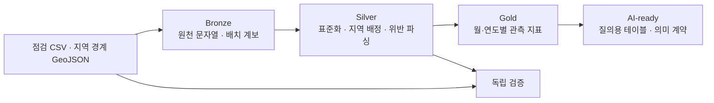

# 05 지역별 식품위생 점검 분석

시카고 77개 Community Area의 **평가 완료 점검 중 불합격 비율과 기록된 위반 유형**을 비교합니다. 점검 좌표를 지역 경계에 배정하고, 월·연도별 지표와 분모를 함께 제공합니다.

## 분석 범위와 결과

팀 통합 입력은 `food_inspections.csv`와 `community_areas.geojson`입니다. 통합 Gold는 01 공용 점검 Silver와 02 위반 관측 결과를 `inspection_key`로 연결합니다. 위반 유형은 `code_system_version`과 문자열 `violation_cd`로 구분합니다. [원천 파일과 프로파일링](05_geospatial/00_origin/README.md)

아래 수치는 **05 로컬 비교 배치**의 전체 시설·점검 유형·위험 등급을 집계한 결과입니다. 관측 기간은 2010년 1월 4일부터 2026년 11월 18일까지입니다. 현재 팀 공용 원천으로 검증한 Bronze·Silver에서도 점검 수, 평가·불합격 건수, 지역 배정 결과가 일치했습니다. [공용본과 로컬 비교](../../reports/05_geospatial/README.md)

| 범위 | 점검 | 평가 완료 | 불합격 | 불합격률 |
| --- | ---: | ---: | ---: | ---: |
| 전체 | 318,627 | 273,488 | 61,344 | 22.43% |
| 지역 배정 | 317,238 | 272,207 | 61,096 | 22.44% |
| 지역 미배정 | 1,389 | 1,281 | 248 | 19.36% |

평가 완료는 통과, 조건부 통과, 불합격의 합입니다. 지역에 배정된 점검은 전체의 99.56%이며, 미배정은 좌표 공란 1,065건과 경계 밖 324건입니다. 평가 완료 점검 45,792건의 위반란이 공란이므로, 위반 기록률은 원문 기록 범위와 함께 해석합니다. [품질 검사](05_geospatial/quality/README.md)

## 단계별 변환 기록

| 단계 | 작업 내용 | 상세 기록 |
| --- | --- | --- |
| 00 Origin | 공용 점검 CSV와 GeoJSON의 범위·키·체크섬 확인 | [00 Origin](05_geospatial/00_origin/README.md) |
| 01 Bronze | 원천 문자열·논리 레코드 순번 보존, 배치 계보 기록 | [01 Bronze](05_geospatial/01_bronze/README.md) |
| 02 Silver | 컬럼 표준화, 점검별 지역 배정, 위반 원문·토큰·고유 코드 구조화 | [02 Silver](05_geospatial/02_silver/README.md) |
| 품질 검사 | 원천·Bronze·Silver 전수 대조, GeoJSON·WKT 비교, 집계 검증 | [품질 검사](05_geospatial/quality/README.md) |
| 03 Gold | 지역·월·연도별 평가 및 위반 지표 집계, 01·02 공용 결과 연결 | [03 Gold](05_geospatial/03_gold/README.md) |
| 04 AI-ready | 안정적인 지역 키, 위반 관측 상태와 지표 의미 계약 제공 | [04 AI-ready](05_geospatial/04_ai_ready/README.md) |

[컬럼 계보 CSV](../../metadata/lineage/05_geospatial/column_lineage.csv)는 16개 Parquet의 출력 컬럼별 입력, 타입, 변환을 기록합니다. 공용 Bronze·Silver 스키마와 로컬에서 재현한 Gold·AI-ready 스키마를 사용했습니다. 파일 경로의 `<batch_id>`, `<rules_id>`, `<gold_id>`, `<release_id>`는 실행별 버전입니다.



## 결과 조회 예시

05 로컬 비교 배치의 2025년 연간 집계입니다. 코드 `47`은 해당 절차 구간에서 식품·비식품 접촉면의 세척 가능성, 설계·구조·사용에 관한 항목으로 기록됐습니다.

| Community Area | 불합격 / 평가 완료 | 불합격률 | 코드 47 기록 / 평가 완료 | 기록률 |
| --- | ---: | ---: | ---: | ---: |
| West Town | 246 / 903 | 27.24% | 284 / 903 | 31.45% |
| Near North Side | 316 / 1,305 | 24.21% | 462 / 1,305 | 35.40% |
| Loop | 187 / 879 | 21.27% | 150 / 879 | 17.06% |

측정 대상은 관측된 점검 기록입니다. 지역을 비교할 때는 시설 구성, 점검 유형, 평가 완료 건수, 위반 기록 범위를 함께 확인합니다. [Gold 지표 정의](05_geospatial/03_gold/README.md#지표-정의)

## 실행

저장소 루트에서 실행합니다. 05 검증 환경은 Python 3.14.7입니다. [05 의존성](../../src/domains/05_geospatial/requirements.txt)

```bash
python3.14 -m venv .venv
source .venv/bin/activate
python -m pip install -r src/domains/05_geospatial/requirements.txt
```

공용 원천 CSV를 아직 복원하지 않았다면 복원 스크립트를 실행합니다. Bronze와 Silver는 다음 명령으로 구축합니다. [공용 원천 복원 기준](../project_setup_and_sharing.md#팀-공용-원천)

```bash
python src/ingestion/restore_origin.py --restore

domain=src/domains/05_geospatial
layers="$(python "$domain/geographic_medallion.py" all)"
printf '%s\n' "$layers"
bronze_dir="$(printf '%s\n' "$layers" | sed -n 's/^Bronze [^:]*: //p')"
silver_dir="$(printf '%s\n' "$layers" | sed -n 's/^Silver [^:]*: //p')"
```

원천 위치는 `--source-dir` 또는 `CHICAGO_RAW_DIR`로 지정합니다. 01·02 공용 Parquet를 받으면 아래 예시의 두 경로를 실제 위치로 바꿔 Gold와 AI-ready를 생성합니다. [공용 입력 스키마](05_geospatial/03_gold/README.md#팀-공용-입력)

```bash
inspection_silver='/path/to/01/inspection_silver.parquet'
violations_dir='/path/to/02/shared_violations'

gold="$(python "$domain/geographic_gold.py" build --silver-dir "$silver_dir" \
  --inspection-silver "$inspection_silver" --shared-violations-dir "$violations_dir")"
printf '%s\n' "$gold"
gold_dir="${gold##*: }"
python "$domain/geographic_ai_ready.py" build --gold-dir "$gold_dir"
```

단계별 출력 폴더는 각 문서의 첫 표에서 확인합니다. 검증에는 구축에 사용한 입력 경로를 전달합니다. [검증 명령](05_geospatial/quality/README.md#검증-실행)

## 로컬 비교 배치 재현

`origin/05_geospatial/`에 저장한 `Food_Inspections_20261120.csv`와 `export.csv`로 이전 비교 결과를 재현합니다. 매니페스트에는 `source_mode=local`이 기록됩니다.

```bash
domain=src/domains/05_geospatial
python "$domain/geographic_medallion.py" all --local-snapshot
gold="$(python "$domain/geographic_gold.py" build --local-snapshot)"
printf '%s\n' "$gold"
python "$domain/geographic_ai_ready.py" build --gold-dir "${gold##*: }"
```

## 코드와 검증 기록

| 코드 | 역할 |
| --- | --- |
| [geographic_medallion.py](../../src/domains/05_geospatial/geographic_medallion.py) | 원천 해시 및 적재 계보 확인, Bronze·Silver 구축 |
| [geographic_boundary.py](../../src/domains/05_geospatial/geographic_boundary.py) | GeoJSON 읽기, 기존 WKT와 도형·배정 비교 |
| [silver_spatial.py](../../src/domains/05_geospatial/silver_spatial.py) | 경계 검증과 Community Area 배정 |
| [silver_violations.py](../../src/domains/05_geospatial/silver_violations.py) | 위반 원문·관측 상태·고유 코드 구조화 |
| [geographic_integration.py](../../src/domains/05_geospatial/geographic_integration.py) | 01 점검 Silver와 02 위반 입력의 타입·키·관측 상태 대조 |
| [geographic_gold.py](../../src/domains/05_geospatial/geographic_gold.py) | 지역·기간별 지표 집계와 대사 |
| [geographic_ai_ready.py](../../src/domains/05_geospatial/geographic_ai_ready.py) | 지역 키·관측 상태 추가와 의미 계약 검증 |
| [audit_geographic_silver.py](../../src/domains/05_geospatial/audit_geographic_silver.py) | 원천·Bronze·Silver 전수 대조와 공간·위반 독립 검증 |

원천 지문, 단계별 검증 결과, 지역별 조회 대사는 [공유 검증 보고서](../../reports/05_geospatial/README.md)에 있습니다.
