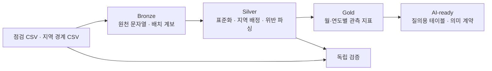

# 05 지역별 식품위생 점검 분석

시카고 77개 Community Area의 **평가 완료 점검 중 불합격 비율과 기록된 위반 유형**을 비교한다. 점검 좌표를 지역 경계에 배정하고, 월·연도별 지표와 지표의 분모를 함께 제공한다.

## 분석 범위와 결과

팀 통합 입력은 `food_inspections.csv`와 `community_areas.geojson`이다. 통합 Gold는 01의 공용 점검 Silver와 02의 위반 관측 결과를 `inspection_key`로 연결한다. 위반 유형의 공용 키는 `code_system_version`과 문자열 `violation_cd`다. [통합 실행 가이드](05_geospatial/runbook.md)

아래 수치는 `Food_Inspections_20261120.csv`와 `export.csv`를 사용한 **05 로컬 비교 배치**에서 재현했다. 관측 기간은 2010년 1월 4일부터 2026년 11월 18일까지이며 모든 시설 유형, 점검 유형, 위험 등급을 포함한다.

| 범위 | 점검 | 평가 완료 | 불합격 | 불합격률 |
| --- | ---: | ---: | ---: | ---: |
| 전체 | 318,627 | 273,488 | 61,344 | 22.43% |
| 지역 배정 | 317,238 | 272,207 | 61,096 | 22.44% |
| 지역 미배정 | 1,389 | 1,281 | 248 | 19.36% |

평가 완료는 통과, 조건부 통과, 불합격의 합이다. 지역에 배정된 점검은 전체의 99.56%이며, 미배정은 좌표 공란 1,065건과 경계 밖 324건이다. 위반란 공란은 평가 완료 점검에서 45,792건으로, 지역별 위반 기록률과 함께 확인할 수 있다. [원천과 검증 결과](../../reports/05_geospatial/README.md)

## 담당 범위와 설계

- **원천 추적** Bronze는 CSV 셀을 문자열로 보존하고 파일 지문, 배치 ID, 논리 레코드 순번을 기록한다.
- **지역 배정** Silver는 유효한 좌표 쌍마다 경계 교차를 한 번 계산한다. 점검 ID별 한 행을 유지하며 미배정 사유와 복수 경계 후보를 보존한다.
- **위반 지표** 하나의 점검에 반복 기록된 위반 코드는 절차 구간별로 한 번만 센다. 코드별 집계와 위반 관측 범위를 별도 테이블로 제공해 평가 분모를 복원할 수 있게 한다.
- **결과 검증** Gold는 월·연도 집계를 Silver와 각각 대조한다. AI-ready는 지역 키와 관측 상태를 제공하고 Gold의 지표·키·타입을 검증한다.

## 결과 조회 예시

05 로컬 비교 배치의 2025년 연간 집계다. 코드 `47`은 해당 절차 구간에서 식품·비식품 접촉면의 세척 가능성, 설계·구조·사용에 관한 항목으로 기록되었다.

| Community Area | 불합격 / 평가 완료 | 불합격률 | 코드 47 기록 / 평가 완료 | 기록률 |
| --- | ---: | ---: | ---: | ---: |
| West Town | 246 / 903 | 27.24% | 284 / 903 | 31.45% |
| Near North Side | 316 / 1,305 | 24.21% | 462 / 1,305 | 35.40% |
| Loop | 187 / 879 | 21.27% | 150 / 879 | 17.06% |

측정 대상은 관측된 점검 기록이다. 지역 간 비교에서는 시설 구성, 점검 유형, 평가 완료 건수, 위반 기록 범위를 함께 확인한다. [지표 정의와 테이블 키](05_geospatial/model.md)

## 재현과 코드

| 확인할 내용 | 위치 |
| --- | --- |
| 입력 준비, 빌드 및 검증 명령 | [실행 가이드](05_geospatial/runbook.md) |
| 지표 분자·분모, 단계별 산출물, 필터와 조회 기준 | [데이터 모델](05_geospatial/model.md) |
| 원천 지문, 팀 입력 대조 및 품질 결과 | [검증 기록](../../reports/05_geospatial/README.md) |
| 구축·공간 배정·위반 파싱·독립 검증 | [Python 소스](../../src/domains/05_geospatial) |
